# BF 베프


> Barrier Free, Best Friend — 함께라서, 조금 더 멀리.

모두에게 열린 여행을 위해 접근성 정보를 찾고, 서로의 여행 경험을 나누는 여행 플랫폼입니다.

[bef-trip.my](https://bef-trip.my)

## 프로젝트 개요

BF 베프는 React와 FastAPI로 구현한 여행 정보 공유 서비스입니다. 한국관광공사의 무장애 여행 데이터를 PostgreSQL에 저장하고, 접근성 조건 검색·카카오 지도·버스 정보·여행 후기·개인 가방 기능을 제공합니다.

프론트엔드는 페이지, 공통 컴포넌트, 상태 관리 훅, API 클라이언트로 나누었으며, 백엔드는 API 라우트와 장소 검색·상세 조회·버스 연동·인증 모듈로 구성했습니다.

## 주요 구현

### 1. 관광지 데이터 수집과 접근성 검색

`backend/update_place.py`에서 한국관광공사 `KorWithService2`의 관광지 목록과 무장애 상세 정보를 조회합니다. 장소 ID를 기준으로 기존 데이터를 확인하고, 신규 장소의 이름·좌표·주소·분류·지역을 DB에 저장합니다. 접근성 상세 응답에서 값이 있는 필드의 키를 추출해 `place.place.tag` 배열로 저장합니다. 수집 요청에는 연결·읽기 시간 제한과 일시적인 오류에 대한 재시도를 적용했습니다.

`backend/place_filter.py`는 검색어, 장소 종류, 접근성 필터를 조합해 SQL 조건을 생성합니다.

- **복수 시설 검색:** PostgreSQL 배열 포함 연산자 `@>`로 선택한 시설을 모두 포함하는 장소를 조회합니다. 필터 값은 FastAPI의 Enum으로 제한하고 중복 선택을 제거합니다.
- **검색어 처리:** 장소명과 주소에 `ILIKE`를 적용하며, 사용자 입력은 SQL 파라미터로 전달합니다.
- **분류 처리:** 기존 DB의 넓은 분류와 장소명 패턴을 조합해 바다·공원·카페 등 화면의 7개 분류로 변환합니다.
- **페이지 처리:** 전체 건수를 별도로 조회하고 `LIMIT`·`OFFSET`으로 결과를 나눕니다. 이름과 ID 순으로 정렬해 조회 순서를 고정합니다.

배열 검색을 위한 GIN 인덱스 SQL은 `backend/sql/create_accessibility_filter_index.sql`에 정의했습니다. 프론트엔드의 편의시설 UI는 이동·출입, 시설 이용, 시각 안내, 청각 안내, 영유아 동반의 5개 그룹으로 구성했습니다.

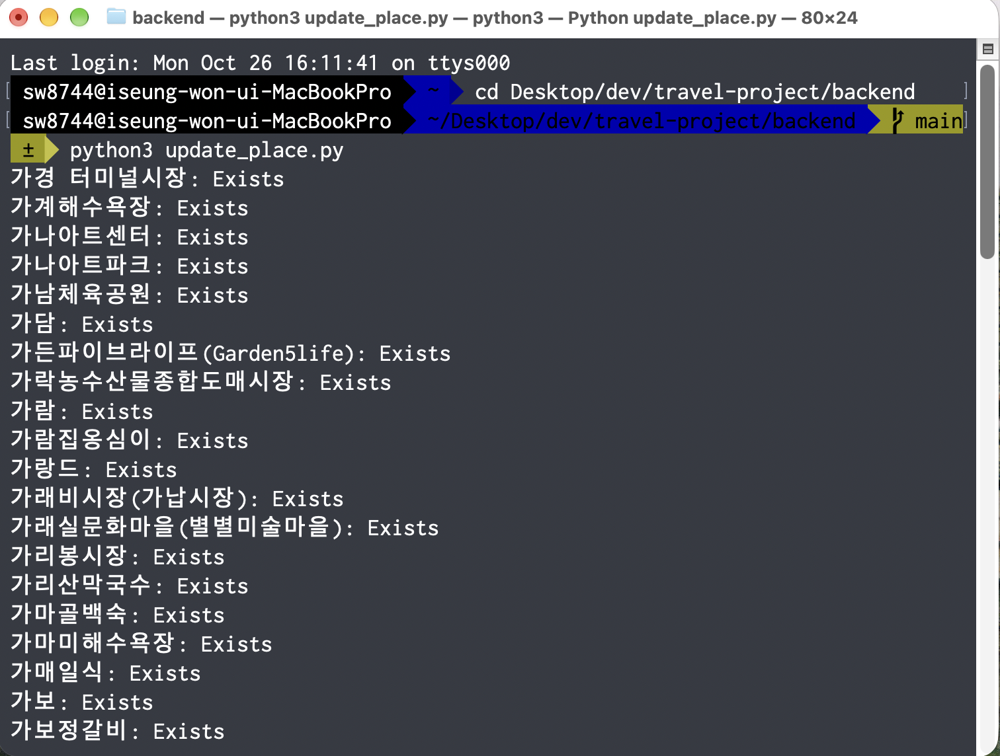

### 2. 장소 상세 정보 결합과 캐시

`backend/place_detail.py`는 DB의 기본 장소 정보에 외부 API의 소개·연락처·사진·편의시설 설명을 결합합니다.

- `detailCommon2`와 `detailWithTour2`를 `ThreadPoolExecutor`로 병렬 조회합니다.
- 외부 응답의 HTML 태그와 엔티티를 정리하고, 사진 URL의 중복을 제거합니다.
- 프로세스 메모리에 최대 256개 장소의 결과를 캐시합니다. 상세 정보가 있으면 1시간, 조회에 실패하거나 정보가 없으면 30초 동안 보관합니다.
- 외부 요청에 실패해도 DB에 저장된 장소 정보는 반환하며, `detail_available`로 상세 정보 제공 여부를 구분합니다.

장소에 연결된 후기는 `place_id`로 장소를 찾은 뒤 장소명과 게시글의 `place` 값을 조인해 조회합니다. 지도 핀과 목록은 같은 장소 선택 상태를 사용해 공통 상세 화면을 엽니다.

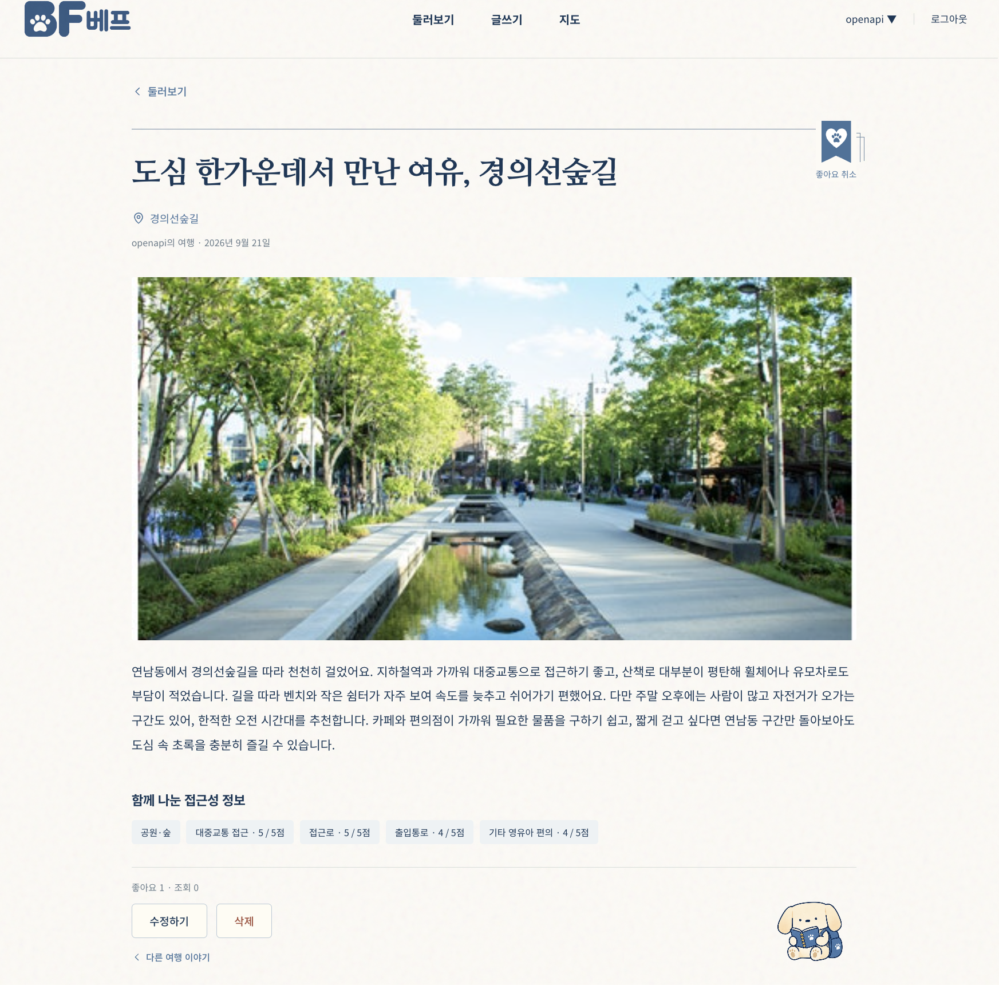
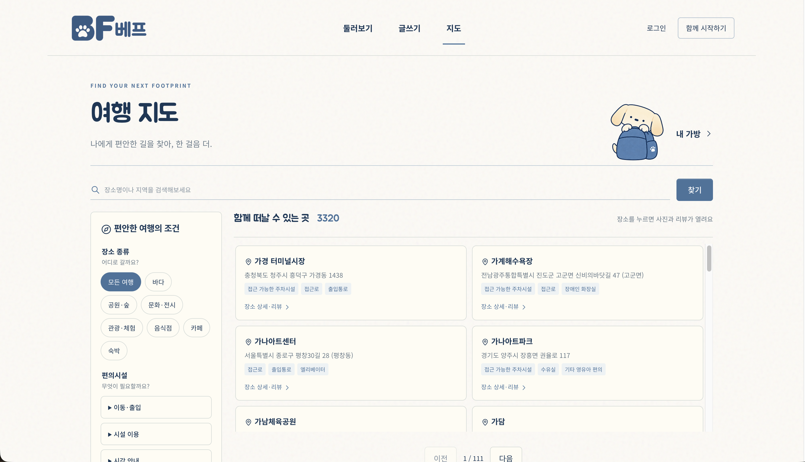

### 3. 지도와 실시간 버스 연동

`frontend/src/components/KakaoMap.jsx`는 카카오 지도 SDK로 장소·정류장·버스 마커와 노선 경로를 표시합니다. 장소 마커는 클러스터로 묶고, 정류장은 지도 확대 수준에 따라 표시합니다. 지도 객체와 마커·경로 객체는 `useRef`로 관리하며, 데이터 변경 시 기존 표시를 정리하고 갱신합니다.

`MapPage.js`는 장소 검색과 교통 정보 요청을 관리합니다.

- 지도 이동 시 중심 좌표로 주변 정류장을 조회하고, 이전 정류장·노선 선택 상태를 초기화합니다.
- 정류장 도착 정보에서 노선 ID를 기준으로 중복을 제거해 노선 목록을 만듭니다.
- 차량 위치와 노선 경로는 `Promise.allSettled`로 병렬 요청합니다. 한쪽만 실패하면 성공한 정보는 표시합니다.
- 선택한 노선의 차량 위치는 30초마다 갱신하고, 선택 변경이나 화면 해제 시 타이머를 정리합니다.
- 요청별 순번을 비교해 이전 정류장이나 노선의 늦은 응답이 현재 화면을 덮어쓰지 않도록 처리합니다.

백엔드는 서울과 그 외 지역의 버스 API를 분기하고, 서로 다른 응답을 프론트엔드에서 사용하는 공통 필드로 변환합니다. 정류장 탐색에는 OpenStreetMap도 활용합니다. 원본 데이터가 차량 종류를 제공하지 않으면 저상버스 여부를 미확인 값으로 반환합니다.

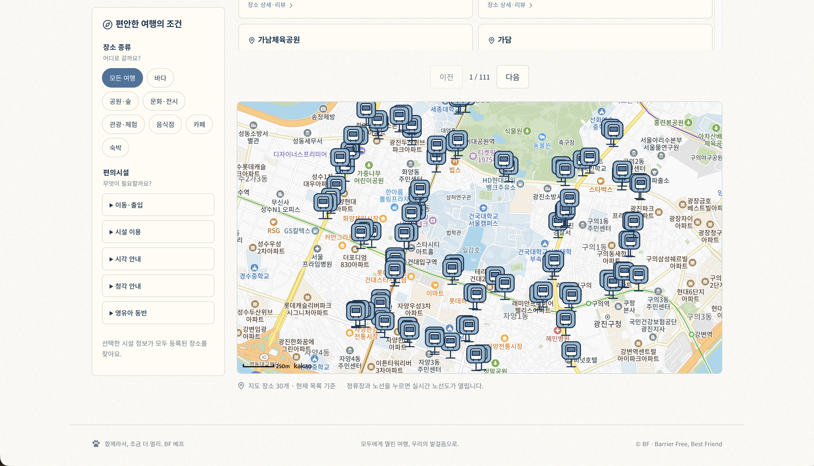
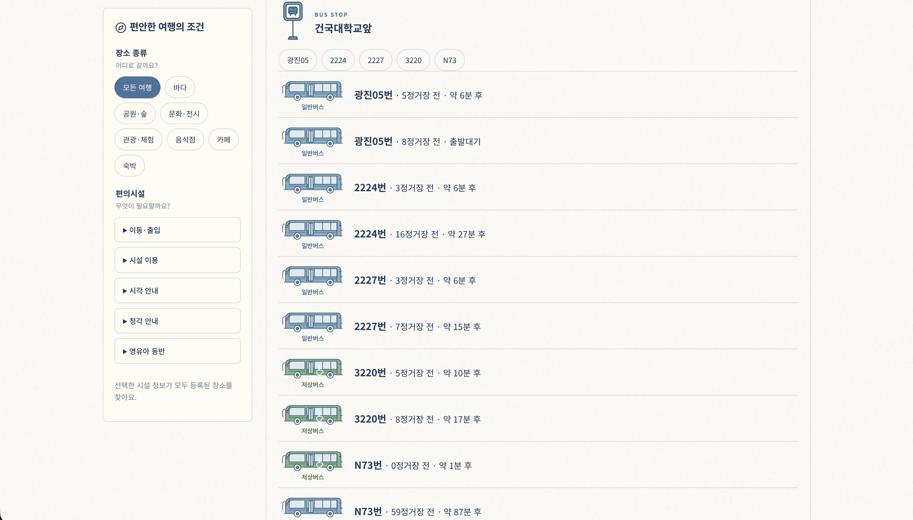
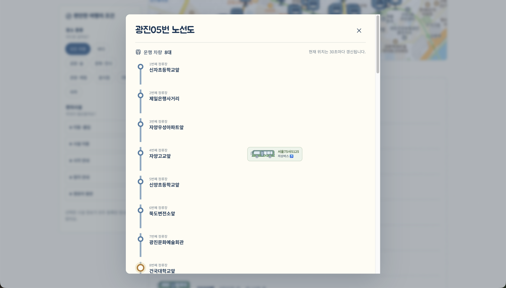

### 4. 여행 기록과 좋아요 처리

게시글은 제목·본문·사진 파일명 배열·장소명·태그 배열을 PostgreSQL에 저장합니다. 편의시설 별점은 `parking|rating:4`처럼 태그 문자열에 인코딩하고, `postUtils.js`에서 라벨과 점수를 분리합니다. 장소 종류는 `category:sea` 형태로 저장하며, 기존 태그 형식도 함께 해석합니다.

- **사진 처리:** 이미지를 먼저 업로드하고 반환된 파일명을 게시글에 저장합니다. 파일은 서버의 `image/`에 보관하고 이미지 API로 제공합니다. 새로 추가한 사진의 순서는 dnd-kit의 드래그와 키보드 조작으로 변경합니다.
- **작성자 검증:** 작성자는 요청 본문 대신 JWT의 사용자 UID로 조회합니다. 수정·삭제 시 본인 글인지 검사하고 SQL에도 작성자 조건을 적용합니다.
- **목록 처리:** 둘러보기에서는 불러온 게시글을 React의 `useMemo`로 검색·필터링하고 최신순 또는 좋아요순으로 정렬합니다. 지도 장소 검색은 서버에서 처리합니다.
- **좋아요 정합성:** 사용자 행과 게시글 행을 `SELECT ... FOR UPDATE`로 잠근 뒤, 사용자의 좋아요 게시글 배열과 게시글의 좋아요 수를 한 트랜잭션에서 갱신합니다. 같은 추가·취소 요청이 반복되어도 수가 중복 반영되지 않도록 검사합니다.

`useLikes`는 좋아요 목록 조회와 오류 상태를 관리하고, 변경 이벤트를 통해 관련 화면의 목록을 다시 불러옵니다.


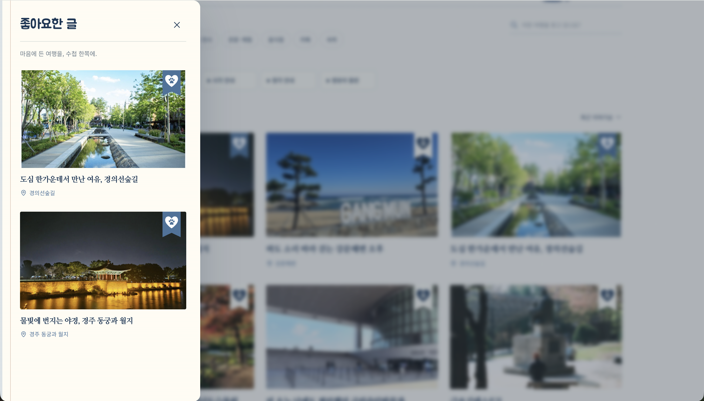

### 5. 인증과 프로필 관리

회원 비밀번호는 bcrypt 해시로 저장합니다. 로그인 시 HS256 JWT를 발급하고, Axios 요청 인터셉터가 브라우저에 저장된 토큰을 `Authorization: Bearer` 헤더에 추가합니다. 백엔드는 `get_current_user_id` 의존성으로 토큰의 서명·만료·용도를 검증하고 사용자 UID를 추출합니다.

가입 인증과 비밀번호 변경 링크는 Gmail SMTP로 발송합니다. 비밀번호 변경에는 로그인 토큰과 구분되는 전용 JWT를 사용하며, 토큰의 인증 식별자를 DB의 미사용 인증 기록과 대조합니다. 비밀번호 갱신과 인증 기록의 사용 처리를 같은 트랜잭션으로 묶어 인증 링크의 재사용을 방지합니다.

프로필의 표시 이름과 사진 파일명, 캐릭터 종류와 꾸미기 값은 Pydantic 모델로 길이·형식·허용 값을 검사한 뒤 저장합니다.

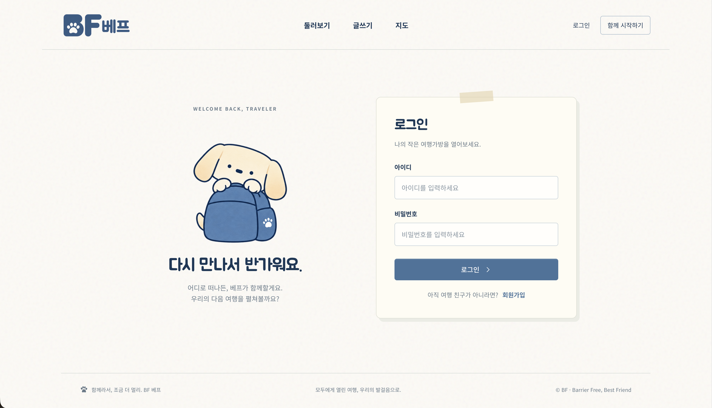
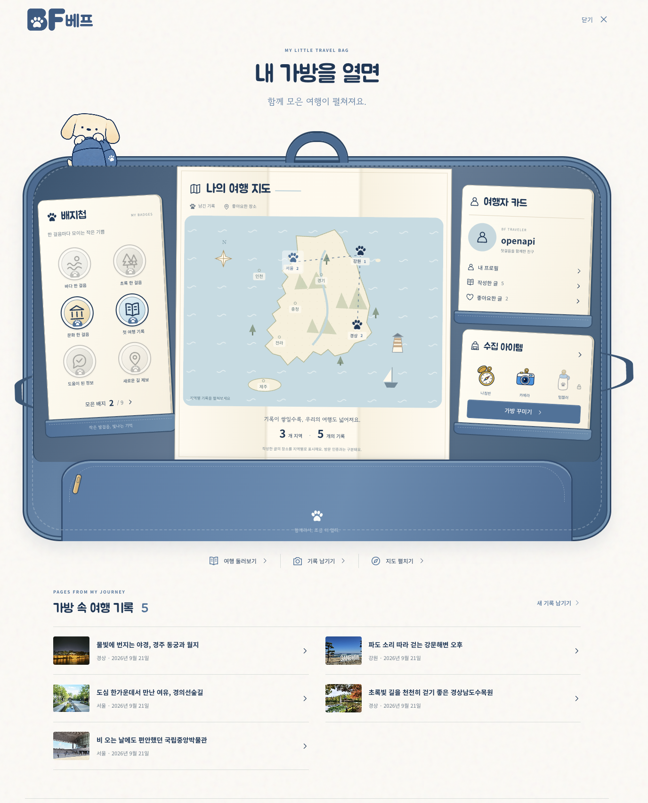

### 6. 배지 계산과 가방 설정 동기화

`frontend/src/data/collection.js`는 작성한 게시글에서 서로 다른 작성일 수, 장소 수, 사진이 있는 글 수 등을 계산해 배지와 아이템 획득 여부를 판정합니다. 획득 상태는 현재 게시글을 기준으로 프론트엔드에서 계산하며, 도움 평가·제보·방문 인증처럼 활동 확인이 필요한 항목은 준비 상태로 표시합니다.

`useBag`는 계정 정보와 게시글을 병렬로 불러온 뒤 본인의 기록을 추출하고, 서버의 꾸미기 설정을 브라우저 저장값과 동기화합니다.

- 캐릭터 종류는 별도 컬럼에, 배지·아이템·친구 이름은 PostgreSQL `JSONB`에 저장합니다.
- 서버에 설정이 없고 기존 브라우저 설정이 있으면 최초 동기화 시 서버로 이전합니다.
- 저장 시 변경된 캐릭터와 꾸미기 항목만 API로 전송하고, 성공 후 `localStorage`를 갱신합니다.
- 배지는 최대 5개, 아이템은 최대 3개로 제한하고 중복·허용되지 않은 값을 정리합니다.
- 캐릭터 변경 이벤트를 발행해 헤더 등 다른 컴포넌트에도 선택 결과를 반영합니다.

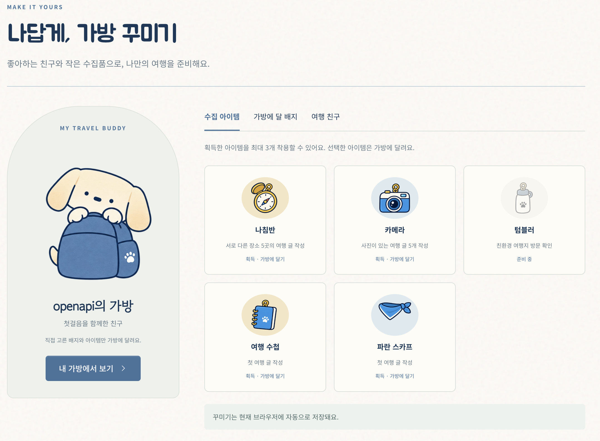
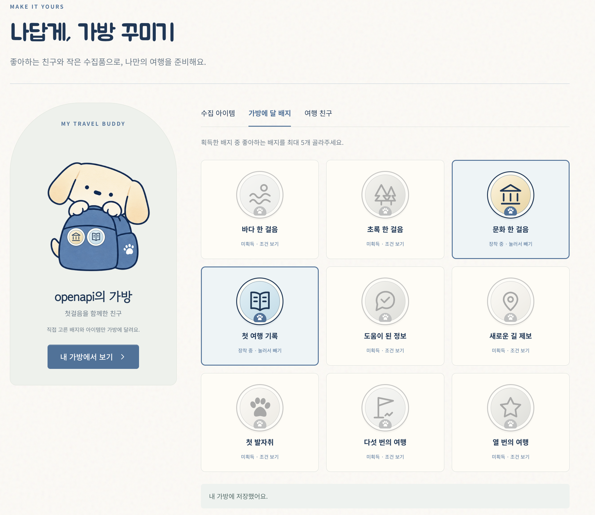
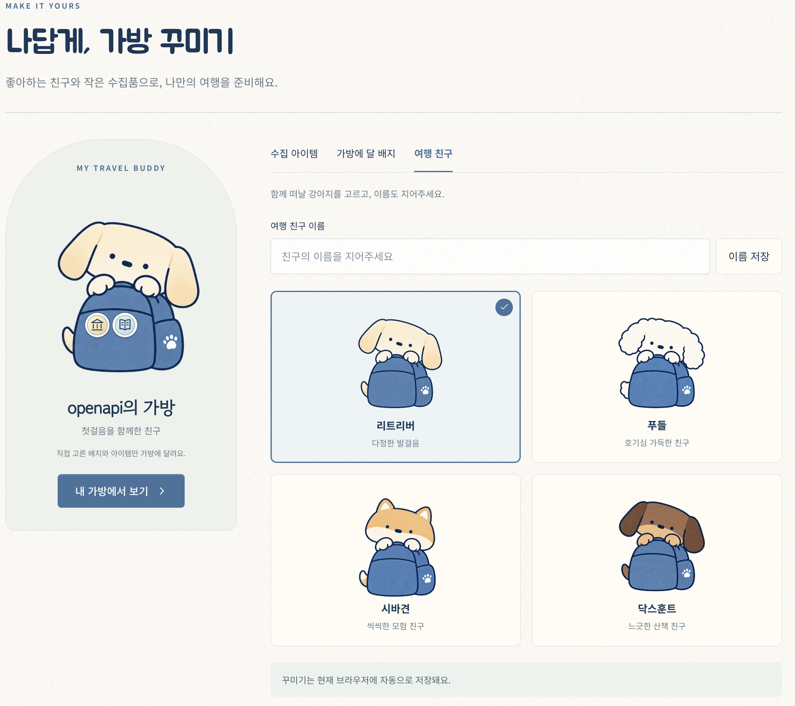

## 시스템 아키텍처

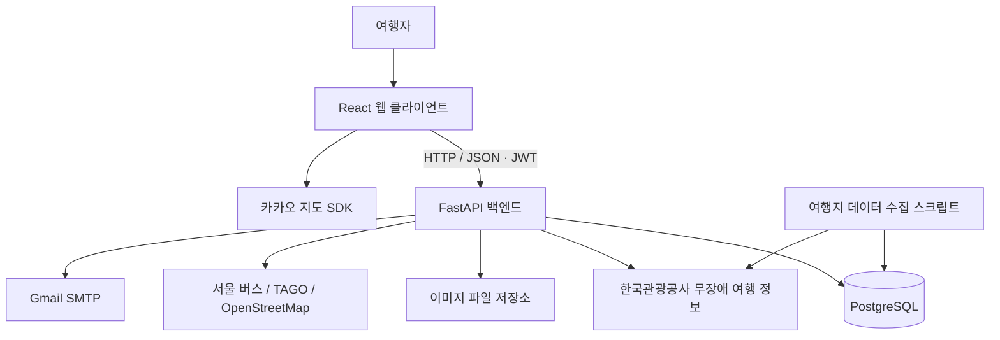

프론트엔드는 여행지·기록·지도·개인 가방 화면을 제공하고, 백엔드는 사용자 인증, 게시글, 장소 검색과 외부 데이터 조회를 처리합니다. 관광지 기본 정보는 수집 스크립트를 통해 DB에 적재하며, 장소 상세와 버스 정보는 외부 API를 활용해 보완합니다.

## 기술 스택

| 구분 | 기술 | 역할 |
| --- | --- | --- |
| 프론트엔드 | React 19, React Router, Axios | 화면 구성, 페이지 이동, API 통신 |
| UI | CSS, SVG, dnd-kit | 반응형 화면, 캐릭터·배지 표현, 사진 순서 변경 |
| 지도 | Kakao Maps JavaScript SDK | 여행지·정류장·버스 위치와 노선 표시 |
| 백엔드 | Python, FastAPI, Uvicorn, Pydantic | REST API와 요청 데이터 검증 |
| 데이터베이스 | PostgreSQL, psycopg2 | 계정, 장소, 게시글과 좋아요 저장 |
| 인증 | JWT HS256, bcrypt | 토큰 인증과 비밀번호 해시 |
| 외부 데이터 | 한국관광공사 KorWithService2, TAGO, 서울 버스 API, OpenStreetMap | 관광·접근성·교통 정보 |
| 이메일 | Gmail SMTP | 가입 인증과 비밀번호 변경 링크 발송 |
| 테스트 | unittest, Jest, React Testing Library | 백엔드 로직과 프론트엔드 동작 검증 |

## 주요 API

| 엔드포인트 | Method | 기능 |
| --- | --- | --- |
| `/places/filters` | GET | 접근성 필터 그룹 조회 |
| `/places` | GET | 검색어·분류·편의시설별 장소 검색 |
| `/places/{place_id}` | GET | 장소 상세 조회 |
| `/places/{place_id}/posts` | GET | 장소에 연결된 여행 기록 조회 |
| `/place-options` | GET | 글쓰기용 장소 목록 조회 |
| `/load-post`, `/posts/{post_id}` | GET | 여행 기록 목록·상세 조회 |
| `/write-post` | POST | 여행 기록 작성 |
| `/edit-post`, `/delete-post` | PUT / DELETE | 본인 여행 기록 수정·삭제 |
| `/posts/{post_id}/like` | POST / DELETE | 좋아요 추가·취소 |
| `/liked-posts` | GET | 좋아요한 여행 기록 조회 |
| `/bus-stations`, `/bus-routes` | GET | 주변 정류장·운행 노선 조회 |
| `/bus-arrival`, `/bus-location`, `/bus-route-path` | GET | 도착 정보·차량 위치·노선 경로 조회 |
| `/register`, `/login` | POST | 회원가입·로그인 |
| `/send-email`, `/validate/{id}` | POST / GET | 가입 인증 메일 발송·인증 처리 |
| `/me` | GET | 내 계정 정보 조회 |
| `/me/profile` | PUT | 표시 이름·프로필 사진 수정 |
| `/me/character`, `/me/character-customization` | PUT | 캐릭터·가방 꾸미기 설정 저장 |
| `/password-change/send-email` | POST | 비밀번호 변경 인증 메일 발송 |
| `/password-change/verify`, `/password-change` | GET / PUT | 인증 링크 검증·비밀번호 변경 |
| `/upload-image/`, `/image/{id}` | POST / GET | 이미지 업로드·조회 |

백엔드 실행 후 `/docs`에서 요청 파라미터와 모델을 확인할 수 있습니다.

## 데이터 구성

| 영역 | 주요 데이터 | 활용 |
| --- | --- | --- |
| 사용자 | 계정, 비밀번호 해시, 이메일, 표시 이름, 프로필 사진 | 인증과 프로필 관리 |
| 인증 | 이메일 인증 식별자, 사용자 연결, 사용 여부 | 가입 인증과 비밀번호 변경 |
| 장소 | 장소 ID, 이름, 좌표, 주소, 분류, 지역, 접근성 정보 | 검색·지도·장소 상세 |
| 여행 기록 | 제목, 작성자, 작성일, 본문, 사진, 장소명, 태그, 조회수 | 여행 경험 공유와 편의시설 평가 |
| 좋아요 | 사용자와 게시글의 연결 | 좋아요 집계와 모아보기 |
| 캐릭터 설정 | 캐릭터 종류, 배지, 아이템, 친구 이름 | 개인 가방 꾸미기 |

현재 장소와 게시글은 장소명으로 연결됩니다. DB 변경용 SQL은 `backend/sql/`에 있으며, 기존 스키마를 보완하는 마이그레이션으로 구성되어 있습니다.

## 프로젝트 구조

```text
travel-project/
├── backend/
│   ├── main.py             # FastAPI 앱과 API 라우트
│   ├── bus_api.py          # 버스·정류장 외부 데이터 처리
│   ├── place_filter.py     # 장소 검색과 접근성 필터
│   ├── place_detail.py     # 장소 상세 정보 조회
│   ├── update_place.py     # 관광지·접근성 데이터 수집
│   ├── auth/               # 로그인, JWT, 이메일 인증
│   ├── util/               # DB 연결과 요청 모델
│   ├── sql/                # DB 스키마 변경 스크립트
│   └── tests/              # 백엔드 테스트
├── frontend/
│   ├── public/             # 정적 파일과 지도 SDK 설정
│   ├── scripts/            # 디자인 미리보기 실행 스크립트
│   └── src/
│       ├── components/     # 지도, 필터, 캐릭터 등 공통 UI
│       ├── pages/          # 둘러보기, 지도, 글쓰기, 내 가방
│       ├── hooks/          # 가방·좋아요 상태 관리
│       ├── data/           # 필터, 지역, 배지·아이템 정의
│       ├── services/       # API 클라이언트
│       └── styles/         # 화면별 스타일
├── docs/                   # 작업 기록과 디자인 문서
├── image/                  # 업로드 이미지
└── README.md
```

## 개발자
| 이름 | 소속 | 역할 |
| --- | --- | --- |
| [이다영](https://github.com/ducknine17) | 서울과학기술대학교 기계시스템공학부 지능형로봇전공 | 팀장, 프론트엔드 |
| [이승원](https://github.com/sw8744) | 건국대학교 컴퓨터공학부 | 프론트엔드, 백엔드, DB 설계 |
| [이정민](https://github.com/ljeongmini0922-dot) | 대구경북과학기술원 기초학부 | 디자인, 테스트 |